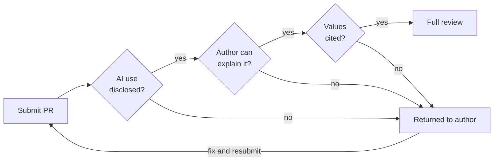

# Request For Comment

- Title: RFC 001: Team AI Use Policy
- Author: Ethan Eggert
- Status: Draft
- Created: 10/20/2026
- Updated: 11/23/2026
- Comment Window: 5 days

## Summary

The goal of this RFC is to codify a new precedent, that you own what you create, regardless of what tools you used to create it, including AI tools. AI tools will continue to be used and allowed within the project, but in exchange, contributors shall disclose AI use, verify AI output against primary sources, and must be able to explain every part of their work during design review.

This policy defines what is and isn't acceptable, how to disclose AI use, the level of human review & verification required, and what happens if a design or submission doesn't meet the standards set by this policy.

## Motivation & Problem Statement

Unreviewed and undisclosed AI output is now present in the project, and it costs valuable review time and introduces risk to our designs.

- **What is wrong right now?**
    - **Correctness:** AI-generated electrical and firmware designs are submitted without or with little human review. Agents are prone to hallucination and generate plausible looking pinouts, fake what functionality components have, and misread or misconstrue electrical characteristics like absolute maximum ratings and timings. At first glance, these hallucinations look correct until someone reads the datasheet.
    - **Missing Context:** AI tools like web chats and agents can never have the full project or issue context and ignore our design guidelines and standards. Aside from it not passing review, the output must also be modified to meet these standards, which wastes everyone's time.
    - **Provenance:** Any comments, research, assumptions, models, and calculations produced by AI tools are not currently attributed, making it hard to tell exactly where a piece of information actually comes from.
    - **Reviewer Burden & Trust Erosion:** Without disclosure, it makes it hard for a reviewer to tell the difference between an arbitrary choice an AI made versus a deliberate one made by a human. In turn, it makes every contribution more suspicious and moves the burden of understanding and untangling disorganized AI output onto the reviewer.
    - **Learning:** In part, this project exists so contributors can build real engineering skills, and when work is completely handed off to an AI tool, the author learns nothing. Even for experienced engineers, AI tool usage can see their skills degrade and review discipline go down.

- **Why don't our existing standards address this?**

Our current design review process, PR templates, and other process documents assume that the author is the one who made every decision and can defend it. This assumption held up until the end of last year during the big design rush and the increased AI tool usage within the team this year.

- **What happens if we do nothing?**
    - Design review becomes the only safeguard, and reviewers absorb the cost of validating the work that the original author did not. This can slow down reviews and drive burnout.
    - Some errors will inevitably get past review, especially ones like pinout or footprint mistakes, that might not be the first place a reviewer will look. If this happens and the error makes it all the way to production, integration, or even flight, it could have catastrophic effects.
    - Thoughts and disagreements about AI usage stay personal and case-by-case.

## Proposed Solution

1. [Human Ownership]: The person who submits any work is its author and is responsible and accountable for all of it. This means that regardless of who generated it (human or AI), if you can't defend it during a design review, it can't be submitted.
2. [Disclosure]: Any contributions where an AI tool meaningfully shaped the content must disclose it with the corresponding level in the section below. Additionally, disclosure does not mean you are "admitting" to anything, and it is treated as a neutral fact about how the work was created, meaning it isn't a problem if AI was used but it cannot be hidden.
3. [Primary Source Verification]: All pinouts, footprints, electrical specifications, timings, and more must be checked against the datasheet.
4. [Attribution of AI-generated Information]: Summaries of papers / datasheets, calculations, notes, and comments produced by AI must be marked as such in a contribution and must be reviewed against a source by a human. Calculations must be reproducable.
5. [Agents Cannot Merge]: AI agents can draft and generate work but may not merge or open PRs. Any wholly AI generated content must be owned by a human author.
6. [Don't Publish Non-Public Information]: Don't paste or upload datasheets or resources under NDA, credentials, or export-controlled information into an AI tool.
7. [Good First Issues]: Issues with the "Good First Issue" tag are primarily for skill-building. For these issues, it's encouraged that the author only use AI for answering questions or explaining concepts but not generating any of the actual work. This is optional though!

## Detailed Specification

### Disclosure Levels


| Level | Covered Content | Disclosure Required |
| ------------- | -------------- | -------------- |
| 0 - None | No AI usage, or usage as something like spell-check, autocomplete, etc. | No |
| 1 - Assisted | AI used to explain concepts, search, brainstorm, or review, but the author created all the content themself | Yes, select level 1 in the PR template, no other info |
| 2 - Co-created | AI generated parts of the content (functions, schematics, calculations, documentation sections) that were subsequently verified by the author | Yes, select level 2 in the PR template, and include which parts, and how they were verified |
| 3 - Generated| Most or all of the content was generated by an AI or agent, with the author reviewing | Yes, select level 3 in the PR template, and a walkthrough of the content during a design review if asked |

### Where the Disclosure Must Go

- **PRs and Design Reviews:** The AI section of the PR template
- **Commits:** Add a git trailer on commits in the following format: `Assisted-By: <tool> (level)`
- **Schematics & Layouts:** A text note on the affected sheet(s) of the schematic that document the AI-assisted portions, until the next design review

### Proposed PR Template Addition

```md
## AI use

- Level: 0 / 1 / 2 / 3
- Tools used:
- Parts generated or co-written:
- How AI-generated parts were verified (sources, tests, sims):
- [ ] I can explain every change in this PR without referring to the tool
- [ ] Values are checked against primary sources (or N/A)
```

### Hardware Expectations

- Every pinout and pin function matches the datasheet exactly
- Footprints match the datasheet land pattern (or modifications are noted)
- Absolute maximum ratings are followed
- Timing, sequencing, etc. is followed and verified by the datasheet
- Citations are recorded for relevant values

### Firmware Expectations

- Any code (AI generated or not) builds, passes tests, and adds new tests for new behavior
- Register addresses, peripheral configuration, and MCU HAL usage is checked against the datasheet / reference manual
- Generated code follows the formatting rules, style guidelines, and design guidelines

### Agent Rules

- Agent work must be on a branch and cannot merge or have protected-branch permissions
- An agent cannot open a PR without a human present and marked as the owner
- Huge agent contributions must be broken up into individually reviewable PRs that a human could have done
- Agent configuration files (e.g., AGENTS.md, skills, etc.) that work with the project standards must also be contributed to the repository and be reviewed

### Review Workflow



### Enforcement?

There is no punishment to using AI, and no one in the project can enforce or punish you or anyone else. The enforcement happens at the review, meaning if the work doesn't meet this policy or the broader project standards it won't pass review. Repeated non-disclosure or other issues will be handled like any other conflict within the project, like a conversation

### Rollout

1. Receive comments & modify the policy during the RFC window
2. The AI section is added to the PR template
3. The policy is codified in the project standards and added to the Wiki
4. After the policy is accepted, it must be applied to any new design reviews

## Drawbacks & Tradeoffs

- Answer the following questions:
    - **Does it increase friction for contributors?** Yes. Level 2 & 3 contributions must be disclosed and have the required notes, citations, verifications, etc. However, this verification should already be taking place during development anyways.
    - **Does it require increased overhead, responsibility, or power for stewards?** No new roles or authority.
    - **Reliance on Honesty:** Disclosure is basically an honor system, but this proposal aims to make it normal and easy so there isn't any reason to hide it.
    - **Risk of Stigma:** If a culture develops where AI use or disclosure is seen as a mark against someone, it will discourage disclosure. We must work to develop a culture where AI use is just a tool and solely judge the work, not the author.
    - **Why the Benefits are Worth It:** Unverified output can lead to bugs, and bugs can lead to failures that cost money, time, respins, or even the mission. By taking a few minutes to disclose AI usage and increase scrutiny of AI tools, it gives us insurance and keeps design review sustainable for everyone.

## Alternatives Considered


| Alternative | Why not |
| -------------- | --------------- |
| Ban AI tools entirely | Unenforcable, makes AI use more secret (the current problem), and discards real benefits like brainstorming, explaining concepts, drafting, search, and more. |
| Do nothing | Puts more verification cost on reviewers and makes handling disagreements harder |
| Adopting an Existing AI Code of Conduct | Most are built for web projects and don't address the problems unique to our workflow and process |


## Open Questions

- Should level 1 disclosure also require the author to list the tools used?
- Should schematics or layout require another reviewer when they contain level 3 content?
- Are local AI tools justifiable for use with NDA / Non-Public Partner documents?
- Anything else?
